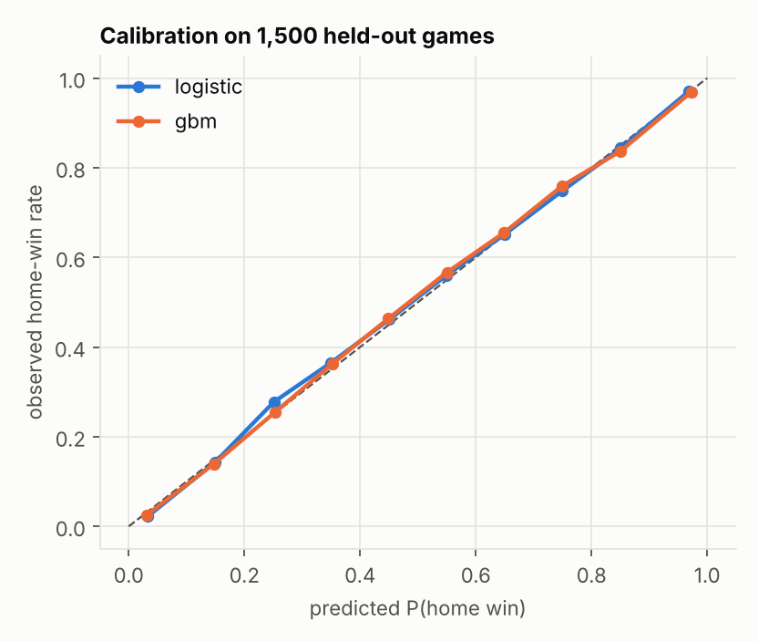
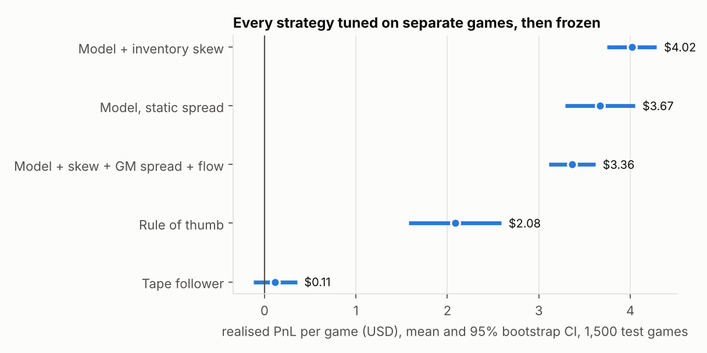
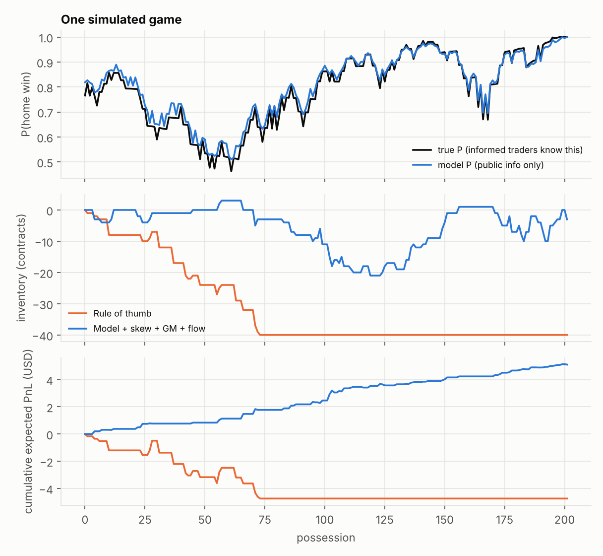
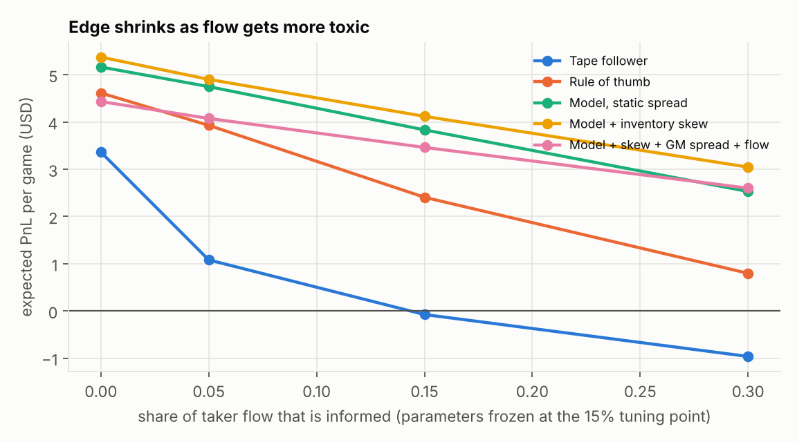

# NBA Live Win-Probability Market Maker (simulation)

A market maker that quotes a **"home team wins" contract** (pays $1 if the home team wins, $0 otherwise) during a basketball game. A live win-probability model supplies the fair value, a limit order book with price-time priority matches orders, and a stream of simulated traders (noise, momentum chasers, informed) trades against the quotes.

**What this is:** a controlled experiment on one question: *how much is a good fair-value model, inventory control and an adverse-selection-aware spread worth to a market maker, measured honestly?*

**What this is not:** a strategy that has traded a real market, or evidence that anyone could make money on real NBA betting markets. The games and the traders are synthetic (see Limitations). Everything reported here is simulated against synthetic market participants.

---

## 1. Run it

```
pip install numpy pandas scipy scikit-learn matplotlib pytest
python -m pytest -q tests              # 16 tests, ~20s
python scripts/eval_winprob.py         # win-prob models on held-out games
python scripts/run_experiment.py       # tune on train games, evaluate on test games (~3.5 min)
python scripts/make_plots.py           # figures in results/
```

| File | What it does |
|---|---|
| `nbamm/gamegen.py` | Possession-by-possession game simulator + the oracle probability |
| `nbamm/winprob.py` | Logistic and gradient-boosted win-probability models, log loss / Brier / calibration |
| `nbamm/book.py` | Limit order book matching engine (price-time priority) |
| `nbamm/strategies.py` | The five quoting strategies |
| `nbamm/market.py` | The simulated market, PnL accounting, bootstrap CIs |
| `tests/test_all.py` | Matching rules, accounting identity, no train/test leakage, calibration of the oracle |

---

## 2. The maths

### 2.1 The contract and why price = probability

The contract pays V = 1 if the home team wins, else 0. A risk-neutral trader's fair price is

```
fair value = E[V | information] = P(home wins | information)
```

So a market maker's job is to estimate a probability, then quote a bid below it and an ask above it. Prices are in cents (1 to 99).

### 2.2 A game as a random walk (the theory behind the model)

Let m_t be the home margin (home minus away points) at time t, let tau be the fraction of the game remaining (tau = seconds left / 2880), and let s be the pre-game expected home margin (the "spread"). Treat the rest of the game as a Brownian-motion-like walk with drift s per full game and standard deviation sigma over a full game:

```
final margin | state  ~  Normal( m + s*tau ,  sigma^2 * tau )

P(home wins) = P(final margin > 0) = Phi( (m + s*tau) / (sigma * sqrt(tau)) )
```

where Phi is the standard normal CDF. Reading it: the numerator is where the margin is expected to end up; the denominator is how much noise is left. Early in the game tau is large, so the noise dominates and the probability stays near the pre-game prior. At the buzzer tau goes to 0 and the probability snaps to 0 or 1 depending on the sign of m. That "z-score" shape is the reason the model's features are `m / sqrt(tau)` and `s * tau / sqrt(tau)` rather than raw margin.

In the simulator, one possession scores 0, 2 or 3 points with probabilities set by team strength. I measured the variance of the final margin over 20,000 simulated games: sigma is about 17.2 points (`POSS_VAR_EFF = 1.48` per possession times 200 possessions). That is **noisier than real NBA games** (roughly 12 to 13), so treat absolute probabilities as illustrative.

### 2.3 The learned model: logistic regression on z-score features

Since Phi(x) is very close to a logistic curve, Phi(x) ~ 1 / (1 + exp(-1.702 x)), a logistic regression on the z-score numerators should recover the theory:

```
logit P(home wins) = b1 * m/sqrt(tau+eps) + b2 * s*tau/sqrt(tau+eps) + b3 * (possession term) + b4 * tau
```

(`eps = 0.01` avoids dividing by zero at the buzzer.) Check against theory: the theory says b1 ~ 1.702 / sigma. The fitted b1 = 0.101, which implies sigma ~ 16.9, versus the true 17.2. The theory also says b1 and b2 should be about equal, since both numerators are in points of margin; fitted b2 = 0.107. The model learned what the maths predicts, which is a sanity check that it is not just memorising noise.

**Training and evaluation are split by whole game**, never by row. Rows from one game are almost copies of each other (the score at possession 80 is nearly the score at possession 79), so a random row split would leak. Same flaw as overlapping return windows in a backtest. A test (`test_split_is_by_game...`) asserts the game ids are disjoint.

Metrics (lower is better), 1,500 held-out games, about 300,000 rows:

| Model | Log loss | Brier | Expected calibration error |
|---|---|---|---|
| Pre-game spread only (ignores the score) | 0.6526 | 0.2305 | 0.0199 |
| **Logistic (ours)** | **0.4356** | **0.1456** | **0.0089** |
| Gradient boosting | 0.4371 | 0.1460 | 0.0086 |
| Oracle (also knows the hidden shock, see 2.4) | 0.4313 | 0.1443 | 0.0065 |

```
log loss = -mean( y*ln(p) + (1-y)*ln(1-p) )        Brier = mean( (p - y)^2 )
```

Takeaways: (1) the score and clock matter hugely (0.65 to 0.44 log loss); (2) gradient boosting does not beat logistic here, because the true relationship really is close to logistic-in-z-score, so extra flexibility only adds variance; (3) the gap to the oracle (0.0043) is the value of information the public does not have, and it is what informed traders exploit. 



### 2.4 Information asymmetry (why a market maker can lose)

Each simulated game has a hidden shock delta ~ Normal(0, 3.5 points): tonight's true strength (injury news, a star sitting out, a team shooting well). True expected margin = s + delta.

- **Public** (everyone, including the market maker): score, clock, possession, pre-game spread s.
- **Private** (informed traders only): delta.

The model's probability p_pub = E[V | public info] is the best estimate from public data. The oracle p_true = P(win | public + delta) is better. An informed trader buys when p_true is sufficiently above the ask and sells when it is below the bid. When they trade, the market maker is on the wrong side. This is **adverse selection**.

### 2.5 Edge per fill and the low-variance PnL estimator

If the maker sells a contract at price a (cents), its true expected value is 100 * p_true, so the expected profit of that fill is a - 100 * p_true. Buying at price b earns 100 * p_true - b. Summing over all fills in a game:

```
expected PnL = sum over fills of  sign * (fill price - 100 * p_true) * quantity / 100
```

Why this is legitimate: p_true is a **martingale** (the best estimate of a future outcome, given everything known, does not drift on average), so the final settlement value of any inventory is correctly accounted for fill by fill. Realised PnL is the same thing plus a big dose of coin-flip noise from who actually wins. The expected-PnL estimator removes that outcome noise, which is why its confidence intervals are roughly 5 times tighter. In the results, realised and expected means agree (for example $4.02 vs $4.01), and a test asserts the two stay within 4 standard errors. I report **realised PnL** as the headline and use expected PnL for tuning and the breakdown by trader type.

### 2.6 Adverse-selection spread (Glosten-Milgrom)

Suppose a fraction pi of order flow is informed (knows V exactly: buys if V = 1, sells if V = 0) and the rest trades randomly, half buys and half sells. Then

```
P(buy | V=1) = pi + (1-pi)/2          P(buy | V=0) = (1-pi)/2
ask = P(V=1 | buy) = p*(pi + (1-pi)/2) / [ p*(pi + (1-pi)/2) + (1-p)*(1-pi)/2 ]     (Bayes)
bid = P(V=1 | sell) by symmetry
```

At p = 0.5 this simplifies to `ask = (1 + pi)/2`, so the **half-spread equals pi/2**: if 10% of flow is informed you must quote 5 cents either side just to break even against them. A test (`test_gm_formulae`) checks both pi = 0 (zero spread) and the pi/2 case.

### 2.7 Inventory risk (mean-variance reservation price)

If the maker holds q contracts (positive = long), terminal wealth is cash + q*V, and with V ~ Bernoulli(p):

```
Var(q*V) = q^2 * p(1-p)
```

A mean-variance maker maximises E[wealth] - (gamma/2) * Var(wealth). Being indifferent about adding one more contract gives the **reservation price**

```
r = p - gamma * (q + 1/2) * p(1-p)   ~   p - gamma * q * p(1-p)
```

Long inventory pushes r down, so both quotes drop: the ask becomes easier to hit (sell more) and the bid harder to hit (stop buying). This is the binary-contract analogue of the Avellaneda-Stoikov reservation price, where the terminal variance of the asset is p(1-p) instead of sigma^2 (T - t). The strategies use r as the centre of their quotes, plus a hard inventory cap of 40 contracts.

### 2.8 Why spreads have an optimum (elastic noise flow)

Noise traders in the simulator are price-sensitive: each has a tolerance w ~ Exponential(mean kappa = 4 cents) and walks away if the half-spread h exceeds w. So the fill probability is `exp(-h/kappa)` and expected spread revenue per noise arrival is

```
f(h) = h * exp(-h/kappa)         f'(h) = exp(-h/kappa) * (1 - h/kappa) = 0  =>  h* = kappa
```

Pure noise flow would justify a 4c half-spread; informed flow pushes the best spread above that. The tuned half-spreads came out at 5 to 8 cents, which fits.

### 2.9 Order-flow adjustment

The "full" strategy also nudges fair value by `lambda * (EMA of signed taker volume)`, a Kyle-style linear price-impact rule: if takers have been net buying, someone may know something, so the maker raises its fair value a little. lambda is tuned.

### 2.10 How results are measured

1. **Tune on separate games.** Each strategy's parameters (spread, gamma, pi, lambda) are grid-searched on 400 tuning games. Every strategy gets the same tuning effort, including the baselines.
2. **Freeze, then test.** Run all strategies on 1,500 fresh games.
3. **Paired comparison.** All strategies face the *same* taker stream in each game (common random numbers), so differences between strategies are not luck of the draw.
4. **Bootstrap.** 95% confidence intervals from 10,000 resamples over *games* (the independent unit), not over possessions or fills.

---

## 3. Results (1,500 held-out games, parameters frozen)

| Strategy | Realised PnL / game [95% CI] | Paired gain vs rule of thumb [95% CI] | Std dev / game | Games profitable |
|---|---|---|---|---|
| Tape follower (EMA of trades, no model) | $0.11 [-0.12, 0.35] | -$1.97 [-2.58, -1.36] | $4.78 | 50% |
| Rule of thumb (score and clock only, static spread) | $2.08 [1.58, 2.59] | baseline | $9.86 | 64% |
| Model fair value, static spread | $3.67 [3.29, 4.05] | +$1.58 [1.08, 2.09] | $7.52 | 77% |
| **Model + inventory skew** | **$4.02 [3.74, 4.29]** | **+$1.93 [1.46, 2.40]** | $5.30 | 81% |
| Model + skew + GM spread + flow | $3.36 [3.11, 3.62] | +$1.28 [0.81, 1.75] | $4.95 | 80% |

Units: contracts pay $1, quoted five lots a side, inventory cap 40. These dollar figures are properties of this simulator, not forecasts.



**What the numbers say, including the unflattering part:**

- A model-driven fair value beats a sensible hand-rule by about $1.6 per game, and the CI excludes zero. Inventory skew adds about $0.35 more *and* cuts the standard deviation from $7.5 to $5.3, because it stops the book drifting to the inventory cap. In the example game traced below, the rule-of-thumb bot sells itself down to -40 contracts by possession 73 and then sits there, exposed.
- **The most sophisticated strategy lost to the simpler one** ($3.36 vs $4.02). Two reasons. The Glosten-Milgrom spread assumes informed traders know the *outcome*, but here they only know a better *probability*, so the formula over-widens near 50% and loses noise volume. And the flow signal adds little (tuned lambda is tiny). More maths did not mean more money, which is a more honest and more interesting result than a clean win.
- Where profit comes from (expected PnL per game, best strategy): +$3.98 from noise traders, +$0.33 from chasers, -$0.30 from informed traders. The business is earning spread from uninformed flow and paying a small toll to informed flow.



### Sensitivity: change the informed share, keep parameters frozen



Every strategy earns less as informed flow grows, which is the point of adverse selection. Paired gain of "Model + skew + GM spread + flow" over the rule of thumb: -$0.18 at 0% informed (it is *worse* when there is no toxicity, because the wide spread is wasted), +$0.15 at 5%, +$1.06 at 15%, +$1.80 at 30%. So the defensive spread only pays off when the flow is actually toxic, and it was tuned at 15%.

---

## 4. Limitations

1. **Synthetic everything.** Games come from a simple possession model (no player-level effects, no fouls or timeouts, no momentum). Real-game variance is lower than here (about 17 vs about 12 to 13 points).
2. **Simulated counterparties.** The informed, noise and chaser traders are my assumptions. The edge is relative to those assumptions; real flow may be better or worse. The sensitivity chart shows how much it matters.
3. **Informed traders know the exact true probability** (whenever their edge exceeds 2c). Real private information is noisier and rarer.
4. **No latency, fees, queue-position games, or partial information leakage** from the order book itself.
5. **One market maker, one contract, one fixed quote size.** No competition among makers, which would compress spreads.
6. **Parameters tuned on 400 games** by grid search with the same effort for every strategy. Test-set numbers are untouched by tuning, but the grid is coarse.
7. **Per-game "information ratio" is not annualised and not a Sharpe ratio.** I deliberately do not quote one: games are the independent unit, there is no calendar time here, and annualising would be the same mistake as in the auction-imbalance project.

---
